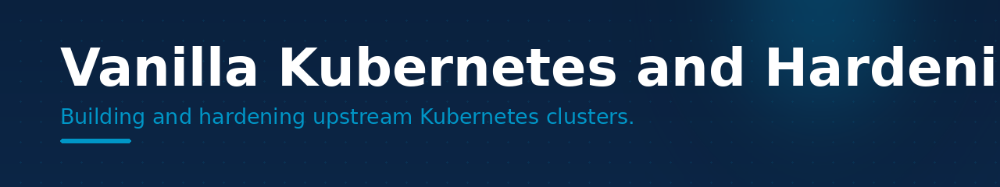

# Vanilla Kubernetes and Hardening

Building and hardening upstream Kubernetes clusters.

## About

**Vanilla Kubernetes and Hardening** is part of a cloud-native platform practice: Kubernetes, GitOps,
and AI infrastructure. This organization groups repositories for one clear domain.

## Explore

Browse the repositories below, or see the full list in the organization's
repository tab.

Maintained by <a href="https://github.com/gadix-labs">gadix-labs</a>

